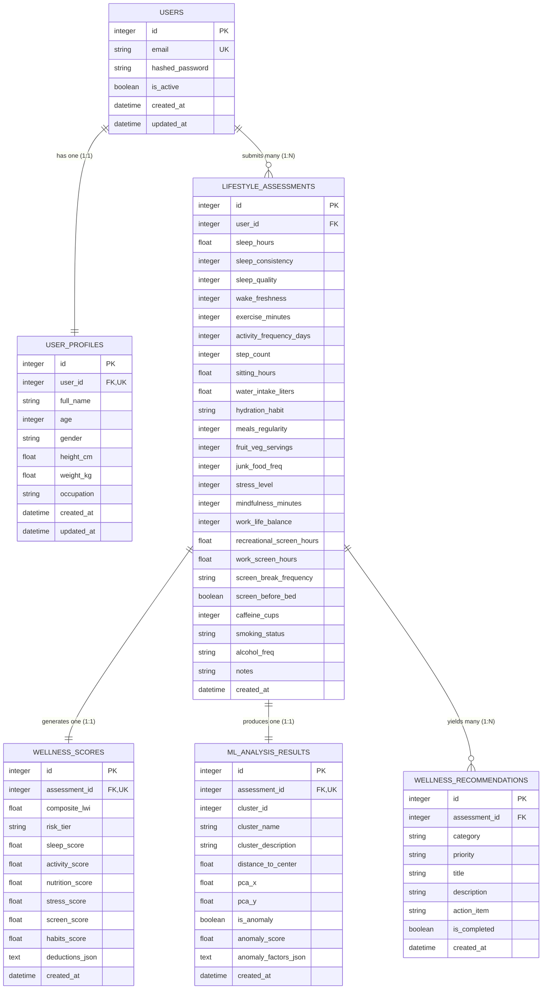

# LifeSync AI – Database Design Document

**Engine:** SQLite 3  
**ORM:** SQLAlchemy 2.0 (Python)  
**File Location:** `backend/lifesync.db` (Local SQLite File)  
**Concurrency Configuration:** Write-Ahead Logging (WAL) + Strict Foreign Key Enforcement  

---

## 1. Overview & SQLite Architecture

LifeSync AI uses SQLite as its embedded relational database. For an academic MCA mini-project, SQLite provides zero-configuration deployment, portability across Windows machines, atomic transactions, and zero external daemon management.

### SQLite Concurrency & Tuning Configuration
To prevent concurrency bottlenecks and eliminate SQLite's `database is locked` error on Windows localhost, the database connection is initialized with:
```sql
PRAGMA journal_mode = WAL;          -- Write-Ahead Logging for simultaneous readers and single writer
PRAGMA synchronous = NORMAL;         -- Balances data safety with high write throughput
PRAGMA foreign_keys = ON;            -- Strict foreign key constraint enforcement
PRAGMA busy_timeout = 5000;          -- 5-second retry timeout for concurrent transactions
PRAGMA cache_size = -64000;          -- 64MB memory cache for fast indexing
```

---

## 2. Implemented Database Schema (6 Relational Tables)



---

## 3. Data Dictionary

### Table 1: `users`
| Column | Type | Constraints | Description |
|---|---|---|---|
| `id` | INTEGER | PRIMARY KEY, AUTOINCREMENT | Unique user identifier |
| `email` | VARCHAR(255) | UNIQUE, NOT NULL, INDEXED | User contact & login email (lowercase) |
| `hashed_password` | VARCHAR(255) | NOT NULL | Bcrypt hash with salt rounds |
| `is_active` | BOOLEAN | NOT NULL, DEFAULT TRUE | Account operational status |
| `created_at` | DATETIME | NOT NULL | Account creation timestamp (UTC) |
| `updated_at` | DATETIME | NOT NULL | Profile last modified timestamp |

### Table 2: `user_profiles`
| Column | Type | Constraints | Description |
|---|---|---|---|
| `id` | INTEGER | PRIMARY KEY, AUTOINCREMENT | Unique profile record ID |
| `user_id` | INTEGER | FOREIGN KEY (`users.id`), UNIQUE, NOT NULL | One-to-one link to user account |
| `full_name` | VARCHAR(100) | NOT NULL | Full name of user |
| `age` | INTEGER | NOT NULL | Age (10 to 120 years) |
| `gender` | VARCHAR(20) | NOT NULL | `male`, `female`, `other`, `prefer_not_to_say` |
| `height_cm` | FLOAT | NULLABLE | Height in centimeters |
| `weight_kg` | FLOAT | NULLABLE | Weight in kilograms |
| `occupation` | VARCHAR(100) | NULLABLE | Academic role or professional occupation |
| `created_at` | DATETIME | NOT NULL | Profile creation timestamp |
| `updated_at` | DATETIME | NOT NULL | Profile update timestamp |

### Table 3: `lifestyle_assessments`
| Column | Type | Constraints | Description |
|---|---|---|---|
| `id` | INTEGER | PRIMARY KEY, AUTOINCREMENT | Unique assessment session ID |
| `user_id` | INTEGER | FOREIGN KEY (`users.id`), NOT NULL, INDEXED | Owner user reference |
| `sleep_hours` | FLOAT | NOT NULL | Average daily sleep duration (0–24) |
| `sleep_consistency` | INTEGER | NOT NULL | Circadian rhythm scale (1–5) |
| `sleep_quality` | INTEGER | NOT NULL | Sleep quality score (1–5) |
| `wake_freshness` | INTEGER | NOT NULL | Morning vitality score (1–5) |
| `exercise_minutes` | INTEGER | NOT NULL | Daily physical activity in minutes |
| `activity_frequency_days`| INTEGER | NOT NULL | Weekly workout frequency (0–7 days) |
| `step_count` | INTEGER | NOT NULL | Estimated daily step count |
| `sitting_hours` | FLOAT | NOT NULL | Sedentary desk hours/day (0–24) |
| `water_intake_liters` | FLOAT | NOT NULL | Daily hydration volume in liters |
| `hydration_habit` | VARCHAR(50) | NOT NULL | Hydration habit pattern |
| `meals_regularity` | INTEGER | NOT NULL | Meal timing consistency scale (1–3) |
| `fruit_veg_servings` | INTEGER | NOT NULL | Daily fruit & vegetable servings |
| `junk_food_freq` | INTEGER | NOT NULL | Fast food / refined snack frequency scale (0–4) |
| `stress_level` | INTEGER | NOT NULL | Perceived psychological stress scale (1–10) |
| `mindfulness_minutes` | INTEGER | NOT NULL | Daily relaxation / meditation minutes |
| `work_life_balance` | INTEGER | NOT NULL | Perceived study/life balance scale (1–5) |
| `recreational_screen_hours`| FLOAT | NOT NULL | Leisure screen time in hours/day |
| `work_screen_hours` | FLOAT | NOT NULL | Productive study/work screen hours/day |
| `screen_break_frequency` | VARCHAR(50) | NOT NULL | Screen rest interval pattern |
| `screen_before_bed` | BOOLEAN | NOT NULL | Blue light exposure within 1h of bedtime |
| `caffeine_cups` | INTEGER | NOT NULL | Daily coffee / tea / energy drink cups |
| `smoking_status` | VARCHAR(50) | NOT NULL | Tobacco consumption pattern |
| `alcohol_freq` | VARCHAR(50) | NOT NULL | Alcohol consumption pattern |
| `notes` | VARCHAR(500) | NULLABLE | Free-text self-reflection notes |
| `created_at` | DATETIME | NOT NULL | Session submission timestamp |

### Table 4: `wellness_scores`
| Column | Type | Constraints | Description |
|---|---|---|---|
| `id` | INTEGER | PRIMARY KEY, AUTOINCREMENT | Unique score ID |
| `assessment_id` | INTEGER | FOREIGN KEY (`lifestyle_assessments.id`), UNIQUE, NOT NULL | Assessment session link |
| `composite_lwi` | FLOAT | NOT NULL | LifeSync Wellness Index (0.0 to 100.0) |
| `risk_tier` | VARCHAR(50) | NOT NULL | `Optimal`, `Good`, `Moderate`, `Elevated` |
| `sleep_score` | FLOAT | NOT NULL | Sleep pillar score (0.0 to 100.0) |
| `activity_score` | FLOAT | NOT NULL | Physical activity pillar score (0.0 to 100.0) |
| `nutrition_score` | FLOAT | NOT NULL | Nutrition & hydration pillar score (0.0 to 100.0) |
| `stress_score` | FLOAT | NOT NULL | Mental wellbeing pillar score (0.0 to 100.0) |
| `screen_score` | FLOAT | NOT NULL | Digital hygiene pillar score (0.0 to 100.0) |
| `habits_score` | FLOAT | NOT NULL | General habits pillar score (0.0 to 100.0) |
| `deductions_json` | TEXT | NOT NULL | JSON serialized array of itemized audit deductions |
| `created_at` | DATETIME | NOT NULL | Score calculation timestamp |

### Table 5: `ml_analysis_results`
| Column | Type | Constraints | Description |
|---|---|---|---|
| `id` | INTEGER | PRIMARY KEY, AUTOINCREMENT | Unique ML record ID |
| `assessment_id` | INTEGER | FOREIGN KEY (`lifestyle_assessments.id`), UNIQUE, NOT NULL | Assessment session link |
| `cluster_id` | INTEGER | NOT NULL | KMeans cluster index (0, 1, 2, or 3) |
| `cluster_name` | VARCHAR(100) | NOT NULL | Assigned population archetype label |
| `cluster_description` | VARCHAR(255) | NULLABLE | Sociodemographic archetype description |
| `distance_to_center` | FLOAT | NOT NULL | Euclidean distance to cluster centroid |
| `pca_x` | FLOAT | NOT NULL | 2D PCA Component 1 coordinate |
| `pca_y` | FLOAT | NOT NULL | 2D PCA Component 2 coordinate |
| `is_anomaly` | BOOLEAN | NOT NULL | Isolation Forest outlier flag |
| `anomaly_score` | FLOAT | NOT NULL | Isolation Forest decision function score |
| `anomaly_factors_json`| TEXT | NOT NULL | JSON serialized array of attributed outlier factors |
| `created_at` | DATETIME | NOT NULL | Model inference timestamp |

### Table 6: `wellness_recommendations`
| Column | Type | Constraints | Description |
|---|---|---|---|
| `id` | INTEGER | PRIMARY KEY, AUTOINCREMENT | Unique recommendation item ID |
| `assessment_id` | INTEGER | FOREIGN KEY (`lifestyle_assessments.id`), NOT NULL, INDEXED | Assessment session link |
| `category` | VARCHAR(100) | NOT NULL | Lifestyle pillar category |
| `priority` | VARCHAR(20) | NOT NULL | `high`, `medium`, `low`, or `positive` |
| `title` | VARCHAR(200) | NOT NULL | Identified observation title |
| `description` | TEXT | NOT NULL | Physiological reason ("Why this works") |
| `action_item` | VARCHAR(255) | NOT NULL | Actionable micro-habit instruction |
| `is_completed` | BOOLEAN | NOT NULL, DEFAULT FALSE | Daily habit completion toggle state |
| `created_at` | DATETIME | NOT NULL | Recommendation generation timestamp |
