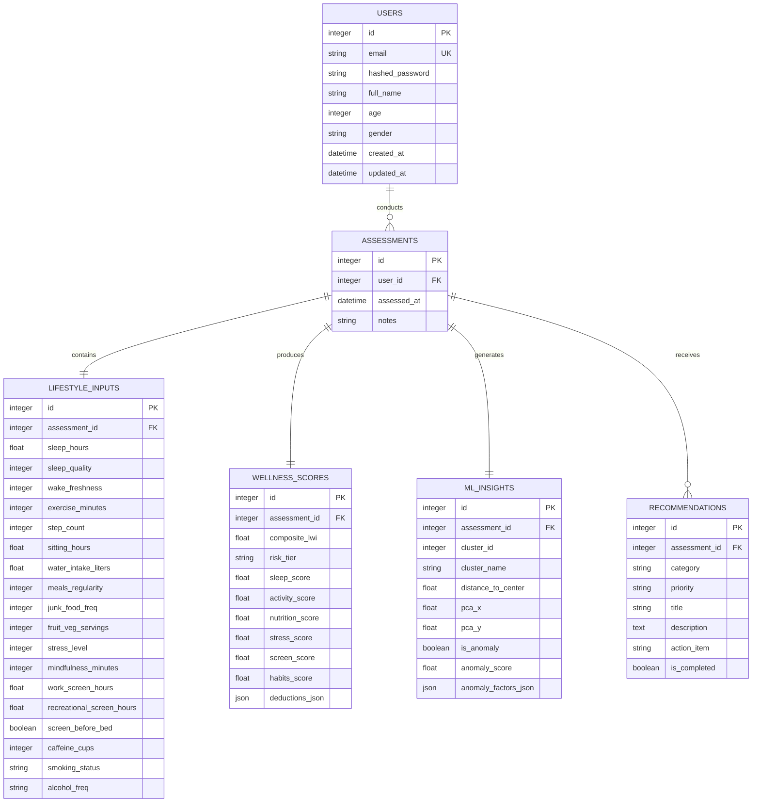

# LifeSync AI – Database Design Document

**Engine:** SQLite 3  
**ORM:** SQLAlchemy 2.0 (Python)  
**File Location:** `backend/lifesync.db` (Local SQLite File)  
**Concurrency Configuration:** Write-Ahead Logging (WAL) + Foreign Key Enforcements

---

## 1. Overview & SQLite Architecture

LifeSync AI uses SQLite as its embedded relational database. For an MCA academic project, SQLite provides zero-configuration deployment, portability across Windows machines, atomic transactions, and zero external daemon management.

### SQLite Concurrency & Tuning Configuration
To prevent concurrency bottlenecks and SQLite's infamous `database is locked` error on Windows localhost, the database connection is initialized with:
```sql
PRAGMA journal_mode = WAL;          -- Write-Ahead Logging for simultaneous readers and single writer
PRAGMA synchronous = NORMAL;         -- Balances data safety with high write throughput
PRAGMA foreign_keys = ON;            -- Strict foreign key constraint enforcement
PRAGMA busy_timeout = 5000;          -- 5-second retry timeout for concurrent transactions
PRAGMA cache_size = -64000;          -- 64MB memory cache for fast indexing
```

---

## 2. Entity-Relationship (ER) Diagram



---

## 3. Detailed Table Schema Definitions

### 3.1 Table: `users`
Stores user profile credentials and demographic details for assessment normalization.

| Column | Type | Constraints | Description |
| :--- | :--- | :--- | :--- |
| `id` | `INTEGER` | `PRIMARY KEY AUTOINCREMENT` | Unique user surrogate key |
| `email` | `VARCHAR(255)` | `UNIQUE NOT NULL` | Login identifier (case-insensitive email) |
| `hashed_password` | `VARCHAR(255)` | `NOT NULL` | Bcrypt password hash string |
| `full_name` | `VARCHAR(100)` | `NOT NULL` | Display name of the user |
| `age` | `INTEGER` | `NOT NULL, CHECK(age >= 10 AND age <= 120)` | Age in years |
| `gender` | `VARCHAR(20)` | `NOT NULL` | Options: `male`, `female`, `other`, `prefer_not_to_say` |
| `created_at` | `DATETIME` | `NOT NULL DEFAULT CURRENT_TIMESTAMP` | Account creation timestamp |
| `updated_at` | `DATETIME` | `NOT NULL DEFAULT CURRENT_TIMESTAMP` | Profile modification timestamp |

*Indices:*
- `idx_users_email` ON `users(email)`

---

### 3.2 Table: `assessments`
Master transaction record representing a specific lifestyle self-assessment session.

| Column | Type | Constraints | Description |
| :--- | :--- | :--- | :--- |
| `id` | `INTEGER` | `PRIMARY KEY AUTOINCREMENT` | Unique assessment session key |
| `user_id` | `INTEGER` | `NOT NULL, FOREIGN KEY REFERENCES users(id) ON DELETE CASCADE` | Link to parent user account |
| `assessed_at` | `DATETIME` | `NOT NULL DEFAULT CURRENT_TIMESTAMP` | Time of questionnaire submission |
| `notes` | `TEXT` | `NULLABLE` | Optional user journal notes regarding this test |

*Indices:*
- `idx_assessments_user_date` ON `assessments(user_id, assessed_at DESC)`

---

### 3.3 Table: `lifestyle_inputs`
Stores the raw questionnaire metrics across all 6 core lifestyle pillars.

| Column | Type | Constraints | Validation Rule |
| :--- | :--- | :--- | :--- |
| `id` | `INTEGER` | `PRIMARY KEY AUTOINCREMENT` | Surrogate key |
| `assessment_id` | `INTEGER` | `UNIQUE NOT NULL, FK -> assessments(id) ON DELETE CASCADE` | 1-to-1 link with assessment |
| `sleep_hours` | `FLOAT` | `NOT NULL` | $0.0 \le \text{val} \le 24.0$ |
| `sleep_quality` | `INTEGER` | `NOT NULL` | $1 \le \text{val} \le 5$ (1=Very Poor, 5=Excellent) |
| `wake_freshness` | `INTEGER` | `NOT NULL` | $1 \le \text{val} \le 5$ (1=Exhausted, 5=Fully Refreshed) |
| `exercise_minutes` | `INTEGER` | `NOT NULL` | $0 \le \text{val} \le 720$ |
| `step_count` | `INTEGER` | `NOT NULL` | $0 \le \text{val} \le 100,000$ |
| `sitting_hours` | `FLOAT` | `NOT NULL` | $0.0 \le \text{val} \le 24.0$ |
| `water_intake_liters` | `FLOAT` | `NOT NULL` | $0.0 \le \text{val} \le 15.0$ |
| `meals_regularity` | `INTEGER` | `NOT NULL` | $1 \le \text{val} \le 3$ (1=Irregular, 2=Somewhat, 3=Consistent) |
| `junk_food_freq` | `INTEGER` | `NOT NULL` | $0 \le \text{val} \le 4$ (0=Never, 1=1-2x/wk, 2=3-4x/wk, 3=Daily, 4=Multiple/day) |
| `fruit_veg_servings` | `INTEGER` | `NOT NULL` | $0 \le \text{val} \le 15$ |
| `stress_level` | `INTEGER` | `NOT NULL` | $1 \le \text{val} \le 10$ (1=Low/Calm, 10=Extreme Burnout) |
| `mindfulness_minutes` | `INTEGER` | `NOT NULL` | $0 \le \text{val} \le 360$ |
| `work_screen_hours` | `FLOAT` | `NOT NULL` | $0.0 \le \text{val} \le 24.0$ |
| `recreational_screen_hours` | `FLOAT` | `NOT NULL` | $0.0 \le \text{val} \le 24.0$ |
| `screen_before_bed` | `BOOLEAN` | `NOT NULL` | True if looking at screens within 60 min of bedtime |
| `caffeine_cups` | `INTEGER` | `NOT NULL` | $0 \le \text{val} \le 20$ (Coffee/Tea/Energy drinks) |
| `smoking_status` | `VARCHAR(20)` | `NOT NULL` | `never`, `occasional`, `frequent` |
| `alcohol_freq` | `VARCHAR(20)` | `NOT NULL` | `none`, `occasional`, `frequent` |

---

### 3.4 Table: `wellness_scores`
Stores the calculated composite score, individual pillar scores, and explainability audit breakdown.

| Column | Type | Constraints | Description |
| :--- | :--- | :--- | :--- |
| `id` | `INTEGER` | `PRIMARY KEY AUTOINCREMENT` | Surrogate key |
| `assessment_id` | `INTEGER` | `UNIQUE NOT NULL, FK -> assessments(id) ON DELETE CASCADE` | 1-to-1 link with assessment |
| `composite_lwi` | `FLOAT` | `NOT NULL` | Overall LifeSync Wellness Index ($0.0 - 100.0$) |
| `risk_tier` | `VARCHAR(30)` | `NOT NULL` | `Optimal`, `Fair`, `Elevated Risk`, `Critical Alert` |
| `sleep_score` | `FLOAT` | `NOT NULL` | Sleep pillar sub-score ($0.0 - 100.0$) |
| `activity_score` | `FLOAT` | `NOT NULL` | Physical activity pillar sub-score ($0.0 - 100.0$) |
| `nutrition_score` | `FLOAT` | `NOT NULL` | Hydration & Nutrition sub-score ($0.0 - 100.0$) |
| `stress_score` | `FLOAT` | `NOT NULL` | Mental wellbeing sub-score ($0.0 - 100.0$) |
| `screen_score` | `FLOAT` | `NOT NULL` | Digital hygiene sub-score ($0.0 - 100.0$) |
| `habits_score` | `FLOAT` | `NOT NULL` | Stimulants / habits sub-score ($0.0 - 100.0$) |
| `deductions_json` | `TEXT` | `NOT NULL` | JSON array of penalty items and explanations |

---

### 3.5 Table: `ml_insights`
Stores unsupervised machine learning outputs (K-Means archetype + Isolation Forest anomaly detection).

| Column | Type | Constraints | Description |
| :--- | :--- | :--- | :--- |
| `id` | `INTEGER` | `PRIMARY KEY AUTOINCREMENT` | Surrogate key |
| `assessment_id` | `INTEGER` | `UNIQUE NOT NULL, FK -> assessments(id) ON DELETE CASCADE` | 1-to-1 link with assessment |
| `cluster_id` | `INTEGER` | `NOT NULL` | Assigned cluster ($0, 1, 2, \text{or } 3$) |
| `cluster_name` | `VARCHAR(100)` | `NOT NULL` | Archetype label (e.g. "Sedentary Digital Workaholic") |
| `distance_to_center` | `FLOAT` | `NOT NULL` | Euclidean distance to cluster centroid |
| `pca_x` | `FLOAT` | `NOT NULL` | Projected 2D PCA X-coordinate for scatter chart |
| `pca_y` | `FLOAT` | `NOT NULL` | Projected 2D PCA Y-coordinate for scatter chart |
| `is_anomaly` | `BOOLEAN` | `NOT NULL` | True if flagged as a multidimensional outlier |
| `anomaly_score` | `FLOAT` | `NOT NULL` | Raw Isolation Forest decision function score |
| `anomaly_factors_json`| `TEXT` | `NOT NULL` | JSON array of features triggering the anomaly flag |

---

### 3.6 Table: `recommendations`
Stores prioritized, actionable wellness guidance for the user.

| Column | Type | Constraints | Description |
| :--- | :--- | :--- | :--- |
| `id` | `INTEGER` | `PRIMARY KEY AUTOINCREMENT` | Surrogate key |
| `assessment_id` | `INTEGER` | `NOT NULL, FK -> assessments(id) ON DELETE CASCADE` | 1-to-Many link with assessment |
| `category` | `VARCHAR(50)` | `NOT NULL` | `Sleep`, `Activity`, `Hydration`, `Stress`, `Screen`, `Habits` |
| `priority` | `VARCHAR(20)` | `NOT NULL` | `high`, `medium`, `low` |
| `title` | `VARCHAR(150)` | `NOT NULL` | Concise advice title |
| `description` | `TEXT` | `NOT NULL` | Explanatory rationale |
| `action_item` | `VARCHAR(255)` | `NOT NULL` | Concrete action step to complete |
| `is_completed` | `BOOLEAN` | `NOT NULL DEFAULT 0` | User checklist toggle for habit tracking |

*Indices:*
- `idx_recommendations_assessment` ON `recommendations(assessment_id)`

---

## 4. Database Initialization & Seeding Script

FastAPI will run a startup initialization hook using SQLAlchemy metadata:
```python
# backend/app/database.py
from sqlalchemy import create_engine, event
from sqlalchemy.orm import sessionmaker, declarative_base

SQLALCHEMY_DATABASE_URL = "sqlite:///./lifesync.db"

engine = create_engine(
    SQLALCHEMY_DATABASE_URL,
    connect_args={"check_same_thread": False}
)

@event.listens_for(engine, "connect")
def set_sqlite_pragma(dbapi_connection, connection_record):
    cursor = dbapi_connection.cursor()
    cursor.execute("PRAGMA journal_mode=WAL")
    cursor.execute("PRAGMA foreign_keys=ON")
    cursor.execute("PRAGMA busy_timeout=5000")
    cursor.close()

SessionLocal = sessionmaker(autocommit=False, autoflush=False, bind=engine)
Base = declarative_base()
```
This guarantees that tables are created automatically on first run without requiring manual database migration tools or Docker containers.
