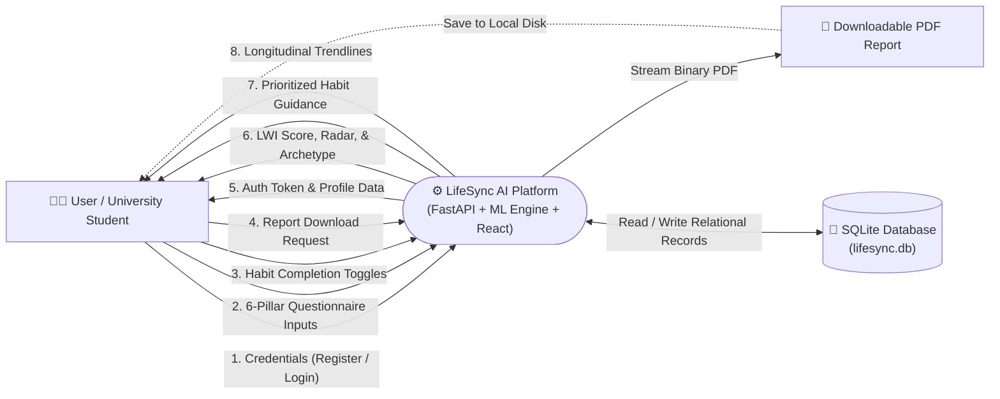
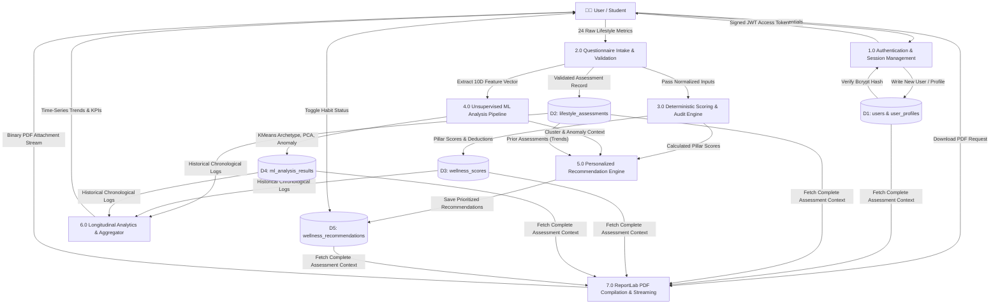
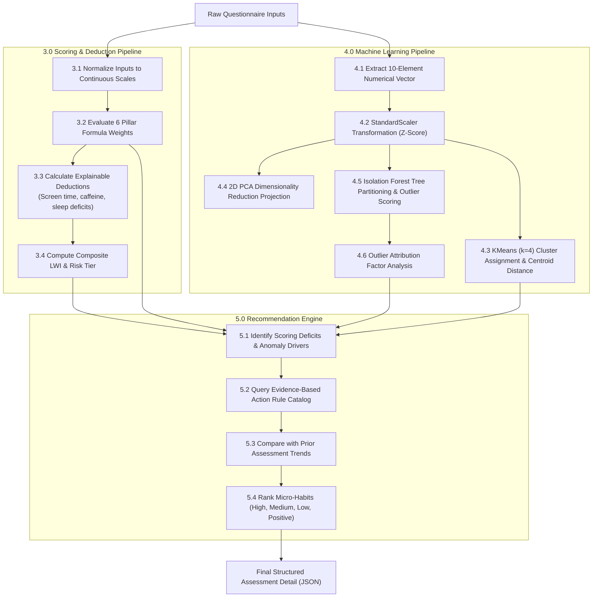

# LifeSync AI — Data Flow Diagrams (DFD Level 0, Level 1, Level 2)

This document specifies the information flow, data transformations, external entities, and data stores operating across LifeSync AI.

---

## 1. DFD Level 0: Context Level Diagram

The Context Diagram defines the external boundary of LifeSync AI, identifying external entities and major information flows into and out of the system.

---

## 2. DFD Level 1: System Process Decomposition

Decomposes the platform into core functional subsystems and demonstrates how data moves across persistent stores.

---

## 3. DFD Level 2: Sub-Process Decomposition (Assessment & AI Pipeline)

Decomposition of **Process 2.0, 3.0, 4.0, and 5.0** demonstrating the internal flow of feature extraction, model inference, and recommendation generation.

---

## 4. Data Dictionary (Data Stores & Flows)

| Identifier | Name | Physical Table / Store | Description |
|---|---|---|---|
| **D1** | Users & Profiles | `users`, `user_profiles` | User authentication records, hashed passwords, contact email, and baseline physical biometrics. |
| **D2** | Lifestyle Assessments | `lifestyle_assessments` | Chronological log of raw self-reported questionnaire inputs across all 6 lifestyle pillars. |
| **D3** | Wellness Scores | `wellness_scores` | Computed pillar scores (0–100), composite LWI, risk tier classifications, and audit deductions. |
| **D4** | ML Analysis Results | `ml_analysis_results` | KMeans cluster archetype assignments, 2D PCA projections, Isolation Forest anomaly flags, and decision scores. |
| **D5** | Wellness Recommendations | `wellness_recommendations` | Prioritized actionable micro-habits, physiological justifications, and completion toggle states. |
