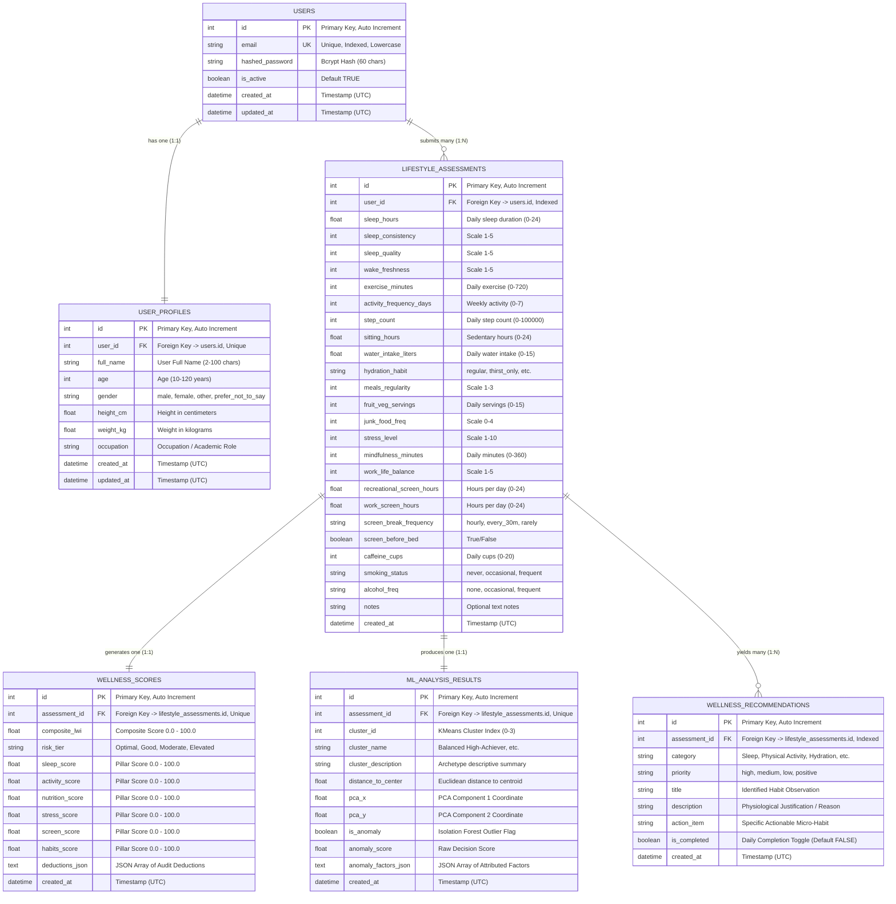

# LifeSync AI — Entity-Relationship (ER) Diagram & Data Dictionary

This document details the relational database schema, entities, attributes, primary/foreign key relationships, and cardinalities implemented in LifeSync AI using SQLite and SQLAlchemy.

---

## 1. Visual Entity-Relationship Diagram

---

## 2. Relational Cardinalities & Constraints

### 2.1 `users` $\rightarrow$ `user_profiles` (One-to-One / 1:1)
- **Constraint:** `user_profiles.user_id` is defined with `unique=True` and `ForeignKey("users.id", ondelete="CASCADE")`.
- **Business Rule:** Every user has exactly one personal demographic profile. Deleting a user account cascades to delete their associated profile.

### 2.2 `users` $\rightarrow$ `lifestyle_assessments` (One-to-Many / 1:N)
- **Constraint:** `lifestyle_assessments.user_id` is a `ForeignKey("users.id", ondelete="CASCADE")` indexed for fast lookup.
- **Business Rule:** A user can submit multiple assessment questionnaires over time, creating a longitudinal historical audit trail.

### 2.3 `lifestyle_assessments` $\rightarrow$ `wellness_scores` (One-to-One / 1:1)
- **Constraint:** `wellness_scores.assessment_id` is defined with `unique=True` and `ForeignKey("lifestyle_assessments.id", ondelete="CASCADE")`.
- **Business Rule:** Each lifestyle questionnaire intake produces exactly one set of explainable scores and composite index.

### 2.4 `lifestyle_assessments` $\rightarrow$ `ml_analysis_results` (One-to-One / 1:1)
- **Constraint:** `ml_analysis_results.assessment_id` is defined with `unique=True` and `ForeignKey("lifestyle_assessments.id", ondelete="CASCADE")`.
- **Business Rule:** Each assessment intake is evaluated once by the Scikit-Learn KMeans, PCA, and Isolation Forest models.

### 2.5 `lifestyle_assessments` $\rightarrow$ `wellness_recommendations` (One-to-Many / 1:N)
- **Constraint:** `wellness_recommendations.assessment_id` is a `ForeignKey("lifestyle_assessments.id", ondelete="CASCADE")`.
- **Business Rule:** Each assessment intake yields between 3 and 10 actionable habit recommendations tailored to detected deficiencies and strengths.

---

## 3. Data Integrity & Storage Engine

- **Database Engine:** SQLite 3 configured with Write-Ahead Logging (`PRAGMA journal_mode=WAL`), eliminating concurrency deadlocks between simultaneous read and write operations.
- **Foreign Key Enforcement:** Enabled on every database connection via `PRAGMA foreign_keys=ON`.
- **Zero Raw Passwords:** Passwords hashed with `bcrypt` (60 ASCII characters) before database insertion. Plaintext passwords are never stored in memory or disk.
