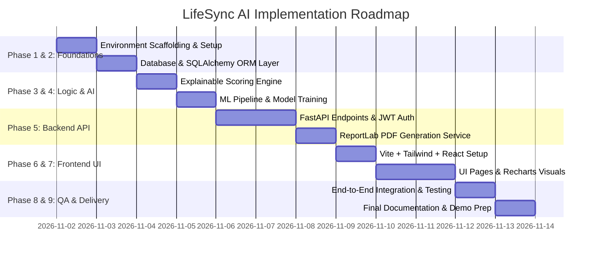

# LifeSync AI – Implementation Plan & Development Roadmap

**Target Project:** LifeSync AI  
**Academic Level:** MCA Mini Project (IBST Track)  
**Execution Environment:** Windows Localhost (Python + Node.js)  
**Estimated Sprint Breakdown:** 9 Modular Phases

---

## 1. Project Directory Structure

```text
c:\Users\badri\Desktop\Lifestyle\
├── backend/
│   ├── app/
│   │   ├── __init__.py
│   │   ├── main.py                     # FastAPI application & lifespan setup
│   │   ├── config.py                   # Environment settings & secrets
│   │   ├── database.py                 # SQLite connection & WAL pragma
│   │   ├── models/                     # SQLAlchemy ORM models
│   │   │   ├── __init__.py
│   │   │   ├── user.py
│   │   │   ├── assessment.py
│   │   │   └── score.py
│   │   ├── schemas/                    # Pydantic schemas (Request/Response)
│   │   │   ├── auth.py
│   │   │   ├── assessment.py
│   │   │   └── analytics.py
│   │   ├── routers/                    # REST API endpoints
│   │   │   ├── auth.py
│   │   │   ├── assessments.py
│   │   │   ├── analytics.py
│   │   │   └── recommendations.py
│   │   ├── services/                   # Business logic services
│   │   │   ├── auth_service.py         # Passwords & JWT
│   │   │   ├── scoring_service.py      # Explainable LWI rules
│   │   │   ├── recommendation_service.py # Action item generation
│   │   │   └── pdf_service.py          # ReportLab generator
│   │   └── ml/                         # Machine learning engine
│   │       ├── train_models.py         # Synthetic generation & training
│   │       ├── inference.py            # Model inference runtime
│   │       └── models/                 # Serialized .pkl files
│   │           ├── scaler.pkl
│   │           ├── kmeans.pkl
│   │           ├── pca.pkl
│   │           └── isolation_forest.pkl
│   ├── requirements.txt
│   └── .env
│
├── frontend/
│   ├── src/
│   │   ├── assets/
│   │   ├── components/
│   │   │   ├── ui/                     # Primitives (Button, Card, Badge, Slider)
│   │   │   ├── charts/                 # Recharts (Radar, Line, Scatter, Bar)
│   │   │   ├── layout/                 # Navbar, Footer, ProtectedRoute
│   │   │   └── assessment/             # 6-step intake wizard components
│   │   ├── context/
│   │   │   └── AuthContext.tsx         # JWT auth state & user session
│   │   ├── pages/
│   │   │   ├── LandingPage.tsx
│   │   │   ├── LoginPage.tsx
│   │   │   ├── RegisterPage.tsx
│   │   │   ├── AssessmentWizardPage.tsx
│   │   │   ├── AssessmentResultsPage.tsx
│   │   │   ├── DashboardPage.tsx
│   │   │   └── HistoryPage.tsx
│   │   ├── services/
│   │   │   └── api.ts                  # Axios client with interceptors
│   │   ├── types/
│   │   │   └── index.ts                # TypeScript interfaces
│   │   ├── App.tsx
│   │   └── main.tsx
│   ├── package.json
│   ├── tailwind.config.js
│   ├── vite.config.ts
│   └── index.html
│
└── docs/                               # Architectural & Academic Specs
    ├── PRD.md
    ├── SYSTEM_ARCHITECTURE.md
    ├── DATABASE_DESIGN.md
    ├── ML_DESIGN.md
    ├── API_DESIGN.md
    ├── UI_UX_DESIGN.md
    ├── IMPLEMENTATION_PLAN.md
    └── TESTING_PLAN.md
```

---

## 2. Phase-by-Phase Roadmap



### Phase 1: Environment Scaffolding & Dependencies
- Set up Python virtual environment (`venv`) on Windows.
- Install backend dependencies: `fastapi`, `uvicorn`, `sqlalchemy`, `pydantic`, `python-jose`, `passlib[bcrypt]`, `scikit-learn`, `pandas`, `numpy`, `reportlab`, `python-multipart`.
- Scaffold Vite frontend with React and TypeScript.
- Install frontend dependencies: `lucide-react`, `recharts`, `axios`, `react-router-dom`, `tailwindcss`, `postcss`, `autoprefixer`.
- Validate zero-dependency Windows execution.

### Phase 2: Database Layer & ORM Implementation
- Construct `database.py` with SQLite WAL mode and foreign key hooks.
- Implement SQLAlchemy ORM models: `User`, `Assessment`, `LifestyleInput`, `WellnessScore`, `MLInsight`, `Recommendation`.
- Write automated table initialization check on application startup.

### Phase 3: Explainable Wellness Scoring Engine
- Implement `scoring_service.py` translating mathematical formulations from `ML_DESIGN.md`.
- Implement unit tests verifying deterministic scoring outputs and deduction audit logging across edge case vectors.
- Implement `recommendation_service.py` to map scores and deductions to prioritized actionable tips.

### Phase 4: Machine Learning Pipeline Development
- Develop `train_models.py` to generate $N=1,500$ realistic lifestyle synthetic records.
- Train Scikit-Learn `StandardScaler`, `KMeans(n_clusters=4)`, `PCA(n_components=2)`, and `IsolationForest(contamination=0.05)`.
- Serialize trained models into `.pkl` / `.joblib` artifacts.
- Develop `inference.py` runtime service and hook into FastAPI `lifespan` state.

### Phase 5: FastAPI REST API & PDF Service
- Develop routers: `/api/auth`, `/api/assessments`, `/api/analytics`, `/api/recommendations`.
- Implement JWT Bearer dependency injection and CORS middleware.
- Build `pdf_service.py` using ReportLab Platypus (clean printable assessment summary with table formatting and scoring badges).

### Phase 6: Frontend Foundation & Design System
- Configure Tailwind CSS color tokens, glassmorphism utilities, and font pairings.
- Implement `api.ts` Axios client with token injection interceptor.
- Implement `AuthContext.tsx` handling login, token storage, and session validation.
- Construct base UI components (`Card`, `Button`, `Badge`, `Slider`, `Modal`).

### Phase 7: Application Pages & Recharts Visualizations
- Develop `LandingPage.tsx` with dynamic lifestyle cards and educational disclaimer.
- Build `LoginPage.tsx` and `RegisterPage.tsx` with full form validation.
- Implement `AssessmentWizardPage.tsx` (6-pillar stepped questionnaire).
- Build `AssessmentResultsPage.tsx` integrating Recharts Radar Chart, score gauge, deduction breakdown, and PDF download.
- Build `DashboardPage.tsx` with longitudinal LWI trends and 2D PCA cluster comparison scatter plot.
- Build `HistoryPage.tsx` with past assessment list, filters, and quick view.

### Phase 8: System Integration & Verification
- Execute full end-to-end user workflows: Registration $\to$ Assessment $\to$ ML Clustering $\to$ Dashboard Visualization $\to$ PDF Export.
- Verify SQLite concurrency under rapid clicking.
- Validate responsive design across screen viewports.

### Phase 9: Academic Documentation & Viva Presentation
- Finalize execution scripts (`run_backend.bat`, `run_frontend.bat`).
- Prepare project viva talking points: Why unsupervised learning was chosen, why explainable heuristics are superior to black-box models for health scoring, and how isolation forest detects compound anomalies.
