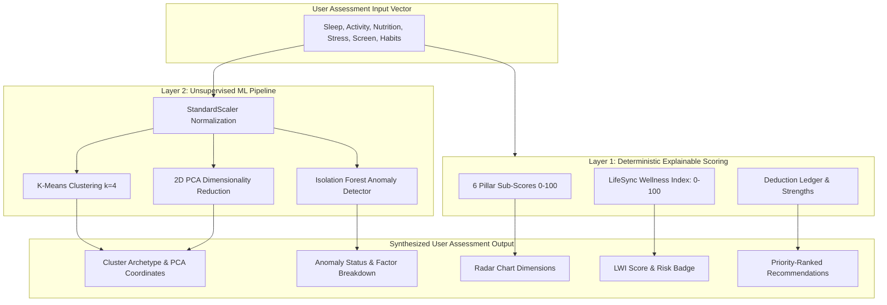

# LifeSync AI – Machine Learning & AI Design Document

**Subsystems:** Explainable Scoring Engine + Unsupervised Machine Learning (K-Means & Isolation Forest)  
**Libraries:** Scikit-Learn 1.4+, Pandas 2.2+, NumPy 1.26+, Joblib  
**Deployment Target:** Embedded In-Memory Python Inference (`app.state`)

---

## 1. Machine Learning & Analytics Philosophy

In clinical and wellness applications, "black-box" neural networks frequently suffer from:
1. Lack of explainability (the user cannot see why they received a specific score).
2. Data hunger (requiring tens of thousands of sensitive health telemetry records).
3. Hallucination or unpredictability when encountering edge cases.

**LifeSync AI adopts a hybrid dual-engine architecture:**
- **Layer 1: Deterministic Heuristic Scoring Engine (Explainable AI):** Computes auditable, mathematically grounded wellness scores and deduction breakdowns aligned with World Health Organization (WHO) and National Sleep Foundation guidelines.
- **Layer 2: Unsupervised Pattern Discovery (K-Means & Isolation Forest):** Discovers population-level lifestyle archetypes and isolates dangerous multidimensional habit anomalies without needing labeled ground-truth health records.



---

## 2. Layer 1: Explainable Wellness Scoring Engine Formulation

Each pillar is evaluated independently from $0.0$ to $100.0$ points. Deductions and bonuses are logged explicitly.

### 2.1 Sleep Score ($S$)
$$\text{Duration Penalty} = 
\begin{cases} 
0 & \text{if } 7.0 \le \text{sleep\_hours} \le 9.0 \\
15 \times |7.0 - \text{sleep\_hours}| & \text{if } \text{sleep\_hours} < 7.0 \\
10 \times (\text{sleep\_hours} - 9.0) & \text{if } \text{sleep\_hours} > 9.0 
\end{cases}$$

$$\text{Quality Factor} = (\text{sleep\_quality} \times 10) + (\text{wake\_freshness} \times 10) \quad (\text{Max } 50 \text{ pts})$$
$$S = \text{Clamp}_{[0, 100]}(50 + \text{Quality Factor} - \text{Duration Penalty})$$

### 2.2 Physical Activity Score ($A$)
- **Base Exercise:** $\min(50, \text{exercise\_minutes} \times 1.25)$ (Full 50 points at 40 minutes).
- **Step Count:** $\min(30, (\text{step\_count} / 10000) \times 30)$ (Full 30 points at 10,000 steps).
- **Sedentary Sitting Penalty:** If $\text{sitting\_hours} > 8.0$, deduction of $(\text{sitting\_hours} - 8) \times 5$ points.
$$A = \text{Clamp}_{[0, 100]}(20 + \text{Base Exercise} + \text{Step Count} - \text{Sedentary Penalty})$$

### 2.3 Nutrition & Hydration Score ($N$)
- **Hydration:** Optimal between $2.5\text{L}$ and $3.5\text{L}$ (35 points). If $< 2.0\text{L}$, deduct $15 \times (2.0 - \text{liters})$.
- **Fruit & Vegetables:** $\min(30, \text{fruit\_veg\_servings} \times 7.5)$ (Full 30 points at 4 servings).
- **Meal Regularity:** Regular = 20 pts, Somewhat = 10 pts, Irregular = 0 pts.
- **Junk Food Penalty:** Frequency $0 \implies 15$ pts, $1 \implies 10$ pts, $2 \implies 5$ pts, $3 \implies 0$ pts, $4 \implies -15$ pts.
$$N = \text{Clamp}_{[0, 100]}(\text{Hydration} + \text{Produce} + \text{Regularity} + \text{JunkFoodScore})$$

### 2.4 Stress & Mental Wellbeing Score ($M$)
- **Stress Inversion:** $(10 - \text{stress\_level}) \times 8$ (Max 80 points at Stress=0/1).
- **Mindfulness Bonus:** $\min(20, \text{mindfulness\_minutes} \times 1.0)$ (Full 20 points at 20 minutes).
$$M = \text{Clamp}_{[0, 100]}(\text{Stress Inversion} + \text{Mindfulness Bonus})$$

### 2.5 Screen & Digital Hygiene Score ($C$)
- **Total Screen Hours:** $\text{total\_screen} = \text{work\_screen\_hours} + \text{recreational\_screen\_hours}$.
- If $\text{total\_screen} \le 6.0 \implies 80$ pts; if $> 6.0 \implies \max(10, 80 - (\text{total\_screen} - 6.0) \times 7)$.
- **Blue Light Pre-Bed Penalty:** If $\text{screen\_before\_bed} == \text{True}$, deduct 20 points.
$$C = \text{Clamp}_{[0, 100]}(\text{Screen Base} - \text{BlueLightPenalty})$$

### 2.6 Habits & Stimulants Score ($H$)
- Base: 100 points.
- Caffeine: If $\text{cups} > 3$, deduct $(\text{cups} - 3) \times 8$.
- Smoking: Never = 0, Occasional = -25, Frequent = -50.
- Alcohol: None = 0, Occasional = -15, Frequent = -35.
$$H = \text{Clamp}_{[0, 100]}(100 - \text{CaffeineDeduction} - \text{SmokingDeduction} - \text{AlcoholDeduction})$$

### 2.7 Composite LifeSync Wellness Index (LWI)
$$\text{LWI} = 0.22 \times S + 0.20 \times A + 0.18 \times N + 0.18 \times M + 0.12 \times C + 0.10 \times H$$

**Risk Tier Mapping:**
- **Optimal Wellness:** $80.0 \le \text{LWI} \le 100.0$
- **Fair / Moderate:** $60.0 \le \text{LWI} < 80.0$
- **Elevated Lifestyle Risk:** $40.0 \le \text{LWI} < 60.0$
- **Critical Lifestyle Alert:** $0.0 \le \text{LWI} < 40.0$

---

## 3. Layer 2: Unsupervised Machine Learning Models

### 3.1 Feature Vector Representation
Each assessment is mapped into an 8-dimensional continuous numerical vector $\vec{x}$:
1. $x_1$: `sleep_hours` (range: $3 - 12$)
2. $x_2$: `exercise_minutes` (range: $0 - 120$)
3. $x_3$: `sitting_hours` (range: $2 - 16$)
4. $x_4$: `water_intake_liters` (range: $0.5 - 5.0$)
5. $x_5$: `stress_level` (range: $1 - 10$)
6. $x_6$: `total_screen_hours` (range: $2 - 18$)
7. $x_7$: `junk_food_freq` (range: $0 - 4$)
8. $x_8$: `caffeine_cups` (range: $0 - 8$)

All features are normalized using `StandardScaler`:
$$z = \frac{x - \mu}{\sigma}$$

---

### 3.2 K-Means Lifestyle Clustering ($k=4$)
**Objective:** Group users into intuitive behavioral archetypes to provide cohort context.

#### Cluster Archetype Profiles:
1. **Cluster 0: "Balanced High-Achiever"**
   - Centroid traits: High sleep ($7.5-8.5\text{h}$), high exercise ($>45\text{m}$), low sitting ($<6\text{h}$), optimal hydration ($>2.5\text{L}$), low stress ($<4$).
   - Goal: Maintenance, micro-adjustments.
2. **Cluster 1: "Sedentary Digital Workaholic"**
   - Centroid traits: Extremely high screen ($>11\text{h}$), high sitting ($>10\text{h}$), moderate/low sleep ($5.5-6.5\text{h}$), high caffeine ($>4\text{ cups}$), low exercise.
   - Goal: Ergonomic interventions, compulsory screen breaks, walking desk routines.
3. **Cluster 2: "Stressed Academic / Crammer"**
   - Centroid traits: High stress ($8-10$), erratic sleep ($4-6\text{h}$), high junk food, low water, irregular meals, high caffeine.
   - Goal: Stress reduction protocols, sleep stabilization, caffeine reduction.
4. **Cluster 3: "Low-Activity Casual"**
   - Centroid traits: Average sleep ($7-8\text{h}$), low exercise ($0-15\text{m}$), moderate screen time, low hydration ($<1.5\text{L}$), moderate stress.
   - Goal: Progressive exercise habit stacking, hydration milestones.

#### 2D Projection via Principal Component Analysis (PCA):
To visualize high-dimensional clusters on the Recharts 2D canvas:
$$\mathbf{z}_{2D} = \mathbf{W}_{PCA}^T \cdot \vec{z} \implies (x, y)$$
The pre-fitted PCA model transforms the user's vector into coordinates plotted against cluster scatter clouds.

---

### 3.3 Isolation Forest Anomaly Detection
**Objective:** Detect acute, compound lifestyle breakdowns that single-metric thresholds miss.

- **Algorithm:** Scikit-Learn `IsolationForest`.
- **Hyperparameters:**
  - `n_estimators = 100`
  - `contamination = 0.05` (5% expected extreme outlier rate)
  - `random_state = 42`
- **Output:**
  - Prediction: $+1$ (Normal), $-1$ (Anomaly).
  - Decision function anomaly score: Ranges from negative (extreme anomaly) to positive (typical profile).
- **Explainability / Attribution:**
  When `is_anomaly == True`, the system identifies which features had a z-score $|z_i| > 2.0$ (e.g., "Screen time is $2.8\sigma$ above normal population; Sleep duration is $-2.4\sigma$ below normal").

---

## 4. Synthetic Baseline Dataset Generation Pipeline

Because real patient/student health telemetry cannot be harvested without Institutional Review Board (IRB) approval, a dedicated dataset generator script (`generate_dataset.py`) creates $N = 1,500$ realistic lifestyle profiles based on normal, log-normal, and truncated distributions calibrated with published health guidelines.

```python
# Synthetic Distribution Calibration Highlights
np.random.seed(42)
# Sleep: Truncated normal, mean=6.8, std=1.4, bounds=[3.0, 11.0]
# Screen: Truncated normal, mean=8.5, std=3.0, bounds=[2.0, 18.0]
# Water: Gamma distribution, shape=3.5, scale=0.6 (mean ~2.1L)
# Exercise: Exponential distribution with right-tail drop, mean=25 min
# Stress: Discrete binomial distribution centered at 6.0
```

The script trains the models and exports:
1. `backend/app/ml/models/scaler.pkl`
2. `backend/app/ml/models/kmeans.pkl`
3. `backend/app/ml/models/pca.pkl`
4. `backend/app/ml/models/isolation_forest.pkl`
5. `backend/app/ml/models/cluster_metadata.json`

---

## 5. Model Inference & Runtime Lifecycle

1. **Startup Lifecycle (`lifespan` in FastAPI):**
   ```python
   @asynccontextmanager
   async def lifespan(app: FastAPI):
       # Load pickled models once into RAM
       app.state.scaler = joblib.load("ml/models/scaler.pkl")
       app.state.kmeans = joblib.load("ml/models/kmeans.pkl")
       app.state.pca = joblib.load("ml/models/pca.pkl")
       app.state.iso_forest = joblib.load("ml/models/isolation_forest.pkl")
       yield
   ```
2. **Inference Latency:**
   In-memory array transformation takes $< 10$ milliseconds on Windows localhost. Zero external network calls.
