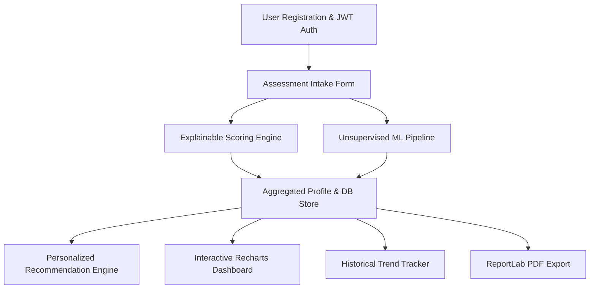

# LifeSync AI – Product Requirements Document (PRD)

**Full Title:** Artificial Intelligence-Based Lifestyle Risk Assessment and Personalized Wellness Recommendation Platform  
**Target Audience / Context:** MCA Mini Project (IBST Track)  
**Academic Year:** 2026–2027  
**Project Classification:** Educational Wellness & Lifestyle Analytics Platform (Non-Clinical / Non-Diagnostic)

---

## 1. Executive Summary & Vision

Modern sedentary lifestyles, irregular sleep cycles, poor hydration habits, excessive screen time, and unbalanced nutrition represent growing contributors to lifestyle health risks among students and working professionals. **LifeSync AI** is an intelligent, privacy-conscious, local-first web platform that empowers users to track, evaluate, and enhance their daily lifestyle metrics through explainable AI models and heuristic wellness algorithms.

LifeSync AI provides an end-to-end self-assessment pipeline featuring:
- A standardized, multi-pillar lifestyle questionnaire.
- An explainable, rule-grounded composite **LifeSync Wellness Index (LWI)** (0–100 scale).
- **K-Means Clustering** to segment users into descriptive lifestyle behavioral archetypes.
- **Isolation Forest** anomaly detection to pinpoint acute lifestyle deviations (e.g., severe sleep deficits, chronic dehydration, critical screen-time overload).
- Automated, actionable, non-clinical lifestyle guidance based on individual risk contributors.
- An interactive, dynamic dashboard visualizing personal trends and comparative metrics.
- Exportable, professional PDF Lifestyle Health Summary Reports.

> [!IMPORTANT]
> **Regulatory & Ethical Disclaimer:** LifeSync AI is strictly an educational wellness self-assessment tool. It does not provide medical diagnoses, clinical treatment plans, or emergency interventions. All recommendations strictly target lifestyle hygiene, ergonomics, and daily habits.

---

## 2. Target Users & Personas

| Persona | Role | Primary Needs | Key Frustrations |
| :--- | :--- | :--- | :--- |
| **Student / Young Professional** | Primary User | Understand how daily study/work habits impact stamina, sleep quality, and stress levels. | Generic advice, complex medical jargon, tedious tracking apps requiring endless manual logging. |
| **Academic Evaluator / Faculty Reviewer** | Project Reviewer | Verify algorithmic validity (K-Means, Isolation Forest), system modularity, clean documentation, and code reproducibility on Windows localhost. | Black-box AI claims, overly bloated enterprise stacks that fail to run locally, lack of explainability. |

---

## 3. Product Goals & Success Metrics

### 3.1 Quantitative Goals
- **Assessment Duration:** Complete 6-pillar lifestyle questionnaire in `< 3 minutes`.
- **Inference Latency:** ML scoring, clustering, and anomaly detection response in `< 500 ms` on Windows localhost.
- **System Footprint:** Zero external daemon dependencies (no Docker, no PostgreSQL, no Redis); executes with standard Python and Node.js runtimes.
- **Report Generation:** PDF compiled and delivered in `< 1.5 seconds`.

### 3.2 Qualitative Goals
- **Explainability:** Users clearly comprehend *why* their score dropped (e.g., "Screen time penalty: -14 pts; Hydration deficit: -8 pts").
- **Visual Polish:** High visual hierarchy using Tailwind CSS, glassmorphism accents, smooth state transitions, and responsive Recharts visualizations.
- **Academic Rigor:** Clean separation between deterministic rule-based baseline scoring and unsupervised machine learning models.

---

## 4. Core Functional Modules

### 4.1 Module 1: Authentication & User Management
- Secure user registration with email, password, full name, age, and gender.
- Passwords hashed using `bcrypt` (or `passlib[bcrypt]`).
- Stateless authentication using JSON Web Tokens (JWT) with HTTP Bearer authorization headers.
- User profile retrieval and session validation.

### 4.2 Module 2: Lifestyle Assessment Intake (6 Core Pillars)
Standardized input capturing daily metrics across 6 fundamental lifestyle dimensions:
1. **Sleep Health:** Hours slept per night, sleep consistency rating, wake-up freshness score (1–5 scale).
2. **Physical Activity:** Active exercise minutes per day, daily step count bracket, sedentary sitting hours per day.
3. **Hydration & Nutrition:** Daily water intake (litres), meals regularity (1–3 meals/day, skipping breakfast flag), daily fruit/vegetable intake servings, junk food frequency.
4. **Stress & Mental Wellbeing:** Self-reported stress level (1–10 scale), daily relaxation/mindfulness time (minutes).
5. **Screen & Digital Habits:** Daily recreational screen time (hours), work screen time (hours), night screen exposure within 1 hour before bed (boolean).
6. **Habits / Stimulants:** Daily caffeinated drinks count, smoking/alcohol frequency (categorical, for risk scoring).

### 4.3 Module 3: Explainable Wellness Scoring Engine
- Deterministic sub-scores calculated per pillar (0 to 100 points each).
- Composite **LifeSync Wellness Index (LWI)** computed via weighted formula:
  $$\text{LWI} = w_{\text{sleep}} S + w_{\text{activity}} A + w_{\text{nutrition}} N + w_{\text{stress}} M + w_{\text{screen}} C + w_{\text{habits}} H$$
- Tier classification:
  - **Optimal (80–100):** Excellent habit balance.
  - **Moderate / Fair (60–79):** Minor risk flags detected; optimization recommended.
  - **Elevated Risk (40–59):** Multiple compromised lifestyle vectors.
  - **Critical Lifestyle Alert (< 40):** Acute compounding lifestyle strain.
- Granular breakdown detailing penalty points and positive bonuses for total explainability.

### 4.4 Module 4: Machine Learning Pipeline
1. **K-Means Lifestyle Clustering ($k=4$):**
   - Segments the user into intuitive behavioral archetypes:
     - *Cluster 0: Balanced High-Achiever* (High activity, regular sleep, balanced stress).
     - *Cluster 1: Sedentary Digital Workaholic* (Extreme screen hours, long sitting, poor sleep).
     - *Cluster 2: Stressed Academic / Crammer* (High stress, irregular nutrition, variable sleep).
     - *Cluster 3: Low-Activity Casual* (Low exercise, moderate screen time, baseline hydration deficit).
   - Generates distance to cluster centroids and PCA coordinates $(x, y)$ for visual scatter plotting.
2. **Isolation Forest Anomaly Detection:**
   - Detects severe multidimensional outlier behavior (e.g., 3 hours sleep combined with 14 hours screen time and 0.5L water).
   - Outputs binary anomaly flag (`Normal` vs `Acute Outlier`) and an anomaly risk score.

### 4.5 Module 5: Personalized Recommendation Engine
- Rule-augmented heuristic mapping that consumes pillar sub-scores, outlier flags, and cluster archetypes.
- Generates 3 prioritized tiers of guidance:
  1. **Immediate High-Priority Actions** (e.g., screen cutoff, hydration alert).
  2. **Habit Building Goals** (e.g., 20-minute daily brisk walking).
  3. **Mindset & Ergonomic Guidance** (e.g., 20-20-20 eye strain rule).

### 4.6 Module 6: Interactive Dashboard & History Tracking
- **KPI Summary Cards:** Current LWI, risk tier badge, anomaly warning badge, cluster archetype tag.
- **Recharts Radar Chart:** 6-pillar multidimensional health wheel.
- **Historical Line Chart:** Longitudinal tracking of LWI across past assessments.
- **Cluster Comparison Plot:** User position relative to benchmark archetypes.
- **Detailed Factor Accordion:** Transparent view of every deduction and recommendation.

### 4.7 Module 7: Downloadable PDF Wellness Summary
- Generates a cleanly styled, single or two-page PDF report.
- Built via Python `ReportLab` (pure Python, zero binary dependencies).
- Contains user details, date, composite score, radar summary table, anomaly notes, and personalized action checklist.

---

## 5. Non-Functional Requirements (NFRs)

### 5.1 Usability & Accessibility
- Clean typography with modern sans-serif fonts (Inter / Outfit).
- Color-coded risk indicators:
  - Optimal: Emerald (`#10B981`)
  - Moderate: Amber (`#F59E0B`)
  - Elevated Risk: Orange (`#F97316`)
  - Critical / Anomaly: Rose (`#F43F5E`)
- Fully responsive design accommodating 1080p desktop down to tablet/mobile viewports.

### 5.2 Performance & Responsiveness
- Client bundle built with Vite for sub-second hot reload and production minification.
- Fast REST responses via asynchronous FastAPI route handlers (`async def`).
- SQLite configured with `PRAGMA journal_mode = WAL;` and proper indices on user foreign keys.

### 5.3 Reliability & Privacy
- Zero cloud transmission: All data remains strictly within the local SQLite database on `localhost`.
- Password hashes securely generated using standard cryptographic salt rounds.
- Graceful validation errors returned using standard HTTP status codes (`400 Bad Request`, `401 Unauthorized`, `404 Not Found`, `422 Unprocessable Entity`).

---

## 6. Constraints & MCA Project Scope Boundaries

| Dimension | Allowed / Included | Explicitly Excluded (Out of Scope) |
| :--- | :--- | :--- |
| **Operating System** | Windows 10/11 Localhost | Linux-only distributions, POSIX-only daemon scripts |
| **Containerization** | None (Direct virtual environment + npm scripts) | Docker, Docker Compose, Kubernetes |
| **Database** | Embedded SQLite 3 (`lifesync.db`) | PostgreSQL, MySQL, MongoDB |
| **In-Memory Cache** | In-process Python dictionaries / caching | Redis, Memcached |
| **Diagnostic Claims**| Lifestyle risk scores & wellness tips | Medical diagnosing, EHR integration, medication advice |
| **External Cloud APIs**| Self-contained local Scikit-Learn models | OpenAI/Claude paid APIs (ensures zero-cost offline grading) |

---

## 7. Assumptions & Dependencies

1. **Python Environment:** Python 3.10+ installed on the host Windows machine.
2. **Node Environment:** Node.js v18+ and npm installed.
3. **Data Availability:** Because student projects cannot easily ethically harvest private clinical telemetry, an initial calibrated synthetic baseline dataset ($N=1,500$) generated using realistic demographic distributions will be used to train and persist the Scikit-learn models (`lifesync_kmeans.pkl` and `lifesync_isolation_forest.pkl`).
