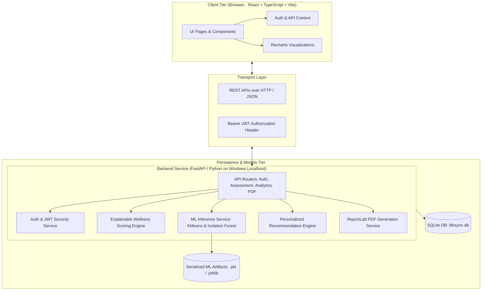
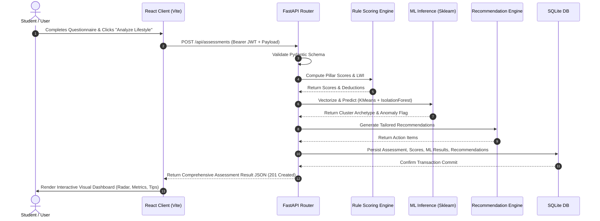

# LifeSync AI – System Architecture Document

**Project Name:** LifeSync AI  
**Full Title:** Artificial Intelligence-Based Lifestyle Risk Assessment and Personalized Wellness Recommendation Platform  
**Architecture Classification:** Lightweight Client-Server Architecture (Localhost Decoupled Full-Stack)

---

## 1. System Architecture Overview

LifeSync AI uses a decoupled client-server architecture designed specifically for rapid development, academic clarity, and seamless Windows localhost execution. 

The architecture consists of:
1. **Frontend Presentation Tier:** A modern Single Page Application (SPA) built with React 18, TypeScript, Tailwind CSS, and Vite, using Recharts for vector-rendered data visualization.
2. **Backend Application Tier:** A high-performance Python ASGI service built with FastAPI, executing business rules, authentication, and report compilation.
3. **Machine Learning & Inference Subsystem:** In-process Scikit-Learn models executing K-Means clustering and Isolation Forest anomaly detection directly within the Python runtime.
4. **Data Persistence Tier:** An embedded SQLite relational database accessed via SQLAlchemy ORM with foreign key integrity and Write-Ahead Logging (WAL).

---

## 2. Comprehensive Module Breakdown

Each module in LifeSync AI is engineered with clean boundaries, transparent data flows, and zero enterprise bloat.

### 2.1 Module 1: Authentication & User Management (`auth`)
- **Purpose:** Manages user identity, registration, login, and issues cryptographic tokens for stateless API authorization.
- **Input:**
  - Registration: `full_name`, `email`, `password`, `age`, `gender`.
  - Login: `email`, `password`.
- **Processing:**
  - Hashes passwords using bcrypt with salt rounds (12 rounds).
  - Validates credentials and generates signed HS256 JSON Web Tokens with a configurable expiry (e.g., 24 hours).
  - Verifies incoming tokens via FastAPI dependency injection (`get_current_user`).
- **Output:**
  - Access token (`access_token`, `token_type: "bearer"`).
  - User profile object (excluding password hash).

### 2.2 Module 2: Questionnaire & Data Ingestion (`assessment`)
- **Purpose:** Collects, sanitizes, and validates multi-pillar lifestyle metrics submitted by the user.
- **Input:**
  - Sleep metrics: `sleep_hours`, `sleep_quality` (1–5), `wake_freshness` (1–5).
  - Physical activity: `exercise_minutes`, `step_count`, `sitting_hours`.
  - Nutrition & Hydration: `water_intake_liters`, `meals_regularity` (1–3), `junk_food_freq` (0–4), `fruit_veg_servings`.
  - Mental wellbeing: `stress_level` (1–10), `mindfulness_minutes`.
  - Screen & Digital habits: `work_screen_hours`, `recreational_screen_hours`, `screen_before_bed` (bool).
  - Stimulants: `caffeine_cups`, `smoking_status`, `alcohol_freq`.
- **Processing:**
  - Pydantic models validate ranges (e.g., $0 \le \text{sleep\_hours} \le 24$, $1 \le \text{stress\_level} \le 10$).
  - Sanitization prevents null pointer exceptions or negative numeric values.
- **Output:** Cleaned, structured Assessment Input entity passed directly to the scoring and ML engines, and stored in the SQLite database.

### 2.3 Module 3: Explainable Wellness Scoring Engine (`scoring`)
- **Purpose:** Computes deterministic, auditable pillar sub-scores and the composite **LifeSync Wellness Index (LWI)** from 0 to 100 without black-box obscurity.
- **Input:** Validated Assessment Input object.
- **Processing:**
  - Calculates individual pillar scores (each mapped to a 0–100 scale using clinical guideline heuristics):
    - Sleep Sub-score ($S$): Evaluates duration against the 7–9 hour optimum, weighted with sleep consistency.
    - Physical Activity Sub-score ($A$): Rewards $>30$ min exercise, penalties for sedentary sitting $>8$ hours.
    - Nutrition & Hydration Sub-score ($N$): Evaluates water intake against a 2.5L–3.5L benchmark, fruit/veg intake, and penalizes junk food frequency.
    - Stress Sub-score ($M$): Inverts self-reported stress and grants bonuses for mindfulness/relaxation time.
    - Screen Time Sub-score ($C$): Penalizes cumulative screen time $>8$ hours and late-night blue light exposure.
    - Habits Sub-score ($H$): Evaluates caffeine, tobacco, and alcohol intake.
  - Computes composite weighted index:
    $$\text{LWI} = 0.22 S + 0.20 A + 0.18 N + 0.18 M + 0.12 C + 0.10 H$$
  - Assigns Risk Tier: Optimal, Fair, Elevated, or Critical.
  - Builds an itemized deduction ledger (e.g., `"-12 points: Screen time exceeds 10 hours/day"`).
- **Output:** Dictionary containing `composite_score`, `risk_tier`, `pillar_scores`, and `deductions_breakdown`.

### 2.4 Module 4: Machine Learning Inference Engine (`ml`)
- **Purpose:** Provides population-level segmentation and detects extreme anomalous lifestyle configurations.
- **Input:** Standardized feature vector derived from the user's assessment (8 normalized numerical features: `sleep_hours`, `exercise_minutes`, `sitting_hours`, `water_intake_liters`, `stress_level`, `total_screen_hours`, `junk_food_freq`, `caffeine_cups`).
- **Processing:**
  - Normalizes features using a persisted `StandardScaler`.
  - **K-Means Model:** Computes cluster assignment (Cluster 0 to 3) and computes Euclidean distance to all 4 cluster centroids; computes 2D coordinates via pre-fitted PCA for visualization.
  - **Isolation Forest Model:** Evaluates multi-dimensional isolation score. If anomaly score $< \text{threshold}$ (or `predict() == -1`), sets `is_anomaly = True`.
- **Output:**
  - `cluster_id`, `cluster_name`, `cluster_description`, `pca_coordinates: [x, y]`.
  - `is_anomaly: bool`, `anomaly_score: float`, `anomaly_contributing_factors: list[str]`.

### 2.5 Module 5: Personalized Recommendation Engine (`recommendations`)
- **Purpose:** Converts quantitative scores and ML cluster insights into non-clinical, actionable lifestyle guidance.
- **Input:** Pillar sub-scores, anomaly flag, identified deductions, cluster archetype.
- **Processing:**
  - Evaluates priority triggers (e.g., if Sleep Sub-score $< 50$, trigger "Sleep Hygiene Protocol"; if `is_anomaly == True`, trigger "Immediate Lifestyle Restructuring Alert").
  - Formulates three tiers of advice:
    1. **Immediate High Priority:** Critical habit adjustments targeting the lowest-scoring pillar.
    2. **Secondary Optimization:** Habit consistency tips for moderate pillars.
    3. **Archetype Guidance:** Tailored advice based on the user's identified cluster persona.
- **Output:** Structured list of recommendation objects containing `category`, `priority` (`high` | `medium` | `low`), `title`, `description`, and `action_steps`.

### 2.6 Module 6: Historical Analytics & Dashboard API (`analytics`)
- **Purpose:** Aggregates longitudinal lifestyle data to compute trajectories, improvement deltas, and multi-assessment comparisons.
- **Input:** User ID and historical assessment records retrieved from SQLite.
- **Processing:**
  - Computes chronological trendlines for LWI and individual pillars.
  - Calculates percentage improvement/deterioration compared to previous assessment.
  - Prepares radar chart schemas and cluster scatterplot data structures.
- **Output:** Formatted JSON payloads consumed directly by React Recharts components.

### 2.7 Module 7: PDF Report Generator (`pdf_report`)
- **Purpose:** Compiles a portable, standalone PDF summary document for offline review.
- **Input:** Assessment ID, user profile, calculated scores, ML insights, recommendations.
- **Processing:**
  - Uses `reportlab.platypus` to layout a multi-page PDF with custom styles, tables, metric badges, and educational disclaimers.
  - Renders directly in-memory into an `io.BytesIO` buffer (no temporary disk writes).
- **Output:** Streaming HTTP response with MIME type `application/pdf`.

---

## 3. Component Interaction & Sequence Flow

---

## 4. Technical Challenges & Architectural Solutions

| Technical Challenge | Root Cause | Architectural Solution in LifeSync AI |
| :--- | :--- | :--- |
| **1. Database Concurrency on Windows** | SQLite default file locking can raise `database is locked` under simultaneous read/write operations. | Configure SQLite with **Write-Ahead Logging (WAL)**: `PRAGMA journal_mode = WAL;` and set a busy timeout of 5000ms in SQLAlchemy connection pool. |
| **2. Cold Start & ML Latency** | Loading Scikit-Learn `.pkl` models from disk on every HTTP request causes severe latency (300ms–1s). | Pre-load models into FastAPI's `app.state` during application startup (`lifespan` handler). Inference executes instantaneously in memory in $< 15$ ms. |
| **3. Lack of Real Clinical Training Data** | An MCA student cannot legally or ethically collect sensitive patient clinical records. | Construct a statistically sound, parameter-calibrated synthetic dataset ($N=1,500$) based on published WHO and sleep foundation epidemiological distributions. Document this transparently as educational synthesis. |
| **4. PDF Generation Failures on Windows** | Libraries like WeasyPrint or wkhtmltopdf require external C++ runtimes, GTK binaries, or external executables that fail on Windows localhost. | Use **ReportLab** (pure Python package). It installs effortlessly via `pip install reportlab` with zero external system binaries or environment variable configuration. |
| **5. ML Model Interpretability** | Raw cluster IDs (e.g., "Cluster 2") and anomaly scores mean nothing to a user or academic evaluator. | Create a deterministic metadata mapping layer: Cluster IDs map to named archetypes with human-readable rationale; Isolation Forest features are back-projected to highlight the specific outliers that triggered the anomaly flag. |
| **6. Frontend State & Route Protection** | Token expiration or page refresh can cause UI flicker or broken API calls. | Implement a dedicated `AuthContext` with local storage persistence, Axios/Fetch interceptor for Bearer token injection, and React Router protected route wrappers. |

---

## 5. Security Architecture (Localhost Scope)

1. **Authentication Token Lifecycle:**
   - JWT tokens signed using HMAC-SHA256 (`HS256`).
   - Secret key stored in `.env` (with a secure fallback default for localhost development).
   - Expiration timestamp (`exp`) embedded in claims.
2. **Password Hashing:**
   - Standard `bcrypt` with automated salt generation. Plaintext passwords never enter logs or database tables.
3. **CORS Policy:**
   - Explicitly restricted to `http://localhost:5173` (Vite dev server) to prevent cross-origin abuse.
4. **Input Validation:**
   - Every inbound payload is rigorously checked by Pydantic v2 schemas to prevent type confusion, negative inputs, and injection attacks.
