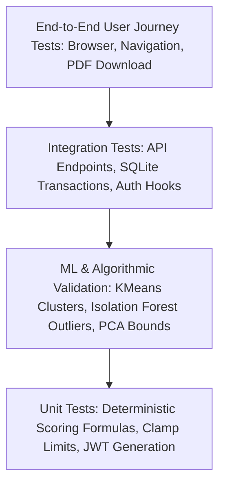

# LifeSync AI – Quality Assurance & Testing Strategy Document

**Project:** LifeSync AI  
**Scope:** Unit, Integration, Machine Learning Validation, and End-to-End System Testing  
**Test Frameworks:** `pytest` (Backend), `httpx` / FastAPI `TestClient`, Manual Cross-Browser Verification

---

## 1. Testing Philosophy & Test Pyramid

For an MCA academic project, testing must verify both algorithmic correctness (scoring formulas and ML inference) and system reliability (database transactions, API security, and responsive UI).

---

## 2. Test Suites & Coverage Strategy

### 2.1 Suite 1: Scoring Engine Unit Testing (`tests/test_scoring.py`)
Validates that the deterministic mathematical scoring rules adhere to defined boundary conditions and produce correct deduction ledgers.

| Test Case ID | Test Scenario | Input Conditions | Expected Outcome |
| :--- | :--- | :--- | :--- |
| `TC-SCORE-01` | Ideal Lifestyle Baseline | Sleep=8h, Exercise=45m, Steps=10,000, Water=3.0L, Stress=2, Screen=5h, Caffeine=1 | $\text{LWI} \ge 88.0$, Risk Tier = `Optimal`, Zero major deductions |
| `TC-SCORE-02` | Acute Burnout Edge Case | Sleep=3h, Exercise=0m, Steps=800, Water=0.8L, Stress=10, Screen=14h, ScreenBeforeBed=True | $\text{LWI} < 35.0$, Risk Tier = `Critical Alert`, Comprehensive deduction ledger |
| `TC-SCORE-03` | Boundary Clamping Check | Extreme out-of-scale values | Sub-scores and LWI strictly clamped in $[0.0, 100.0]$ |
| `TC-SCORE-04` | Deduction Transparency | Screen time = 12h, Water = 1.0L | Explicit string explanations returned in `deductions` list |

---

### 2.2 Suite 2: Machine Learning Subsystem Validation (`tests/test_ml.py`)
Validates that trained Scikit-learn models deliver reliable, predictable inferences without runtime crashes.

| Test Case ID | Test Scenario | Test Logic | Success Criteria |
| :--- | :--- | :--- | :--- |
| `TC-ML-01` | Model Artifact Integrity | Check presence of `scaler.pkl`, `kmeans.pkl`, `pca.pkl`, `isolation_forest.pkl` | All models load into memory via `joblib.load()` without warnings |
| `TC-ML-02` | K-Means Cluster Assignment | Pass normalized feature vector of typical balanced student | Assigned cluster $c \in \{0, 1, 2, 3\}$; distance to centroid $> 0.0$ |
| `TC-ML-03` | PCA Coordinate Projection | Project 8D standardized vector to 2D space | Returns array of shape `(2,)` with finite floats (no `NaN` or `Inf`) |
| `TC-ML-04` | Isolation Forest Outlier Trigger | Inject extreme lifestyle vector ($>3\sigma$ sleep deficit and $>3\sigma$ screen time) | Model outputs `is_anomaly == True`, `anomaly_score < 0.0` |
| `TC-ML-05` | Anomaly Feature Attribution | Inspect anomaly explanation output | Highlights the specific outlier dimension (e.g. "Screen time") |

---

### 2.3 Suite 3: Backend REST API Integration Testing (`tests/test_api.py`)
Uses FastAPI's `TestClient` (backed by an in-memory SQLite test database).

| Test Case ID | Endpoint | Method | Preconditions / Payload | Expected HTTP Code & Assertion |
| :--- | :--- | :--- | :--- | :--- |
| `TC-API-01` | `/api/auth/register` | `POST` | Valid user payload | `201 Created`, valid JWT returned, password not exposed |
| `TC-API-02` | `/api/auth/register` | `POST` | Duplicate email payload | `400 Bad Request` ("Email already registered") |
| `TC-API-03` | `/api/auth/login` | `POST` | Invalid password | `401 Unauthorized` |
| `TC-API-04` | `/api/assessments` | `POST` | Missing authorization header | `401 Unauthorized` |
| `TC-API-05` | `/api/assessments` | `POST` | Valid assessment payload with Bearer JWT | `201 Created`, assessment ID returned, scores and ML present |
| `TC-API-06` | `/api/assessments/{id}` | `GET` | Assessment created by User A requested by User B | `404 Not Found` (strict tenancy isolation) |
| `TC-API-07` | `/api/assessments/{id}/pdf` | `GET` | Valid assessment ID | `200 OK`, `Content-Type: application/pdf`, non-empty stream |
| `TC-API-08` | `/api/recommendations/{id}/toggle` | `PATCH` | Valid recommendation ID | `200 OK`, `is_completed` toggled to `true` |

---

### 2.4 Suite 4: Frontend UI & Interactive Testing
Manual and browser-verified functional checklists.

1. **Questionnaire Wizard Integrity:**
   - Sliders respond smoothly to mouse dragging and keyboard arrows.
   - Step navigation buttons (`Next`, `Back`) disable appropriately at boundary steps.
   - Form state persists across steps without resetting previous responses.
2. **Recharts Rendering:**
   - Radar Chart renders all 6 axes without label collision.
   - Tooltips show accurate values on hover.
   - Scatter plot displays cluster benchmark points with distinctive colors and clearly marks the user's current coordinate.
3. **Responsive Viewport Testing:**
   - Desktop 1920x1080: Multi-column layout with split dashboard cards.
   - Laptop 1366x768: Fluid card wrapping.
   - Tablet / Mobile 768px: Single-column stacked cards, full-width touch-friendly sliders.

---

### 2.5 Suite 5: Windows Localhost Environment Checklist
Specific tests tailored to the Windows localhost deployment constraint:

1. **Path Separator Compatibility:** Ensure all file paths in Python use `pathlib.Path` or `os.path.join` to avoid backslash escaping bugs on Windows.
2. **SQLite File Lock Test:** Run 10 rapid concurrent API requests to ensure `PRAGMA journal_mode = WAL;` prevents `sqlite3.OperationalError: database is locked`.
3. **Port Conflict Recovery:** Verify graceful error messaging if port `8000` (FastAPI) or `5173` (Vite) is occupied.
4. **Clean Virtual Environment Build:** Verify backend runs seamlessly inside standard Python `venv` without requiring external global system compilers.
