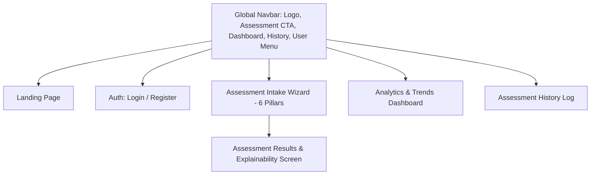

# LifeSync AI – UI/UX Design Document

**Framework:** React 18, TypeScript, Vite  
**Styling Engine:** Tailwind CSS 3.4+  
**Icons:** Lucide React  
**Charts & Visuals:** Recharts  
**Design Philosophy:** Modern Dark/Light Hybrid, Glassmorphism Accents, Rich Health-Tech Visual Hierarchy

---

## 1. Visual Identity & Design System

LifeSync AI incorporates a clinical-clean, tech-forward aesthetic. Rather than basic, flat tables, it employs rounded cards with subtle borders, gentle glassmorphism gradients, and distinct color-coded semantic cues.

### 1.1 Color Palette & Semantic Tokens
- **Background Deep:** Slate 950 (`#020617`) and Slate 900 (`#0F172A`)
- **Card Surface & Glass:** Slate 800 (`#1E293B`) with `backdrop-blur-md` and `border-slate-700/60`
- **Brand Primary Accent:** Cyan/Indigo gradient (`from-cyan-500 to-indigo-600`)
- **Semantic Wellness Tiers:**
  - **Optimal (80–100):** Emerald Green (`#10B981` / `text-emerald-400`, `bg-emerald-500/10`)
  - **Fair / Moderate (60–79):** Amber (`#F59E0B` / `text-amber-400`, `bg-amber-500/10`)
  - **Elevated Risk (40–59):** Orange (`#F97316` / `text-orange-400`, `bg-orange-500/10`)
  - **Critical Alert / Anomaly (< 40):** Rose / Crimson (`#F43F5E` / `text-rose-400`, `bg-rose-500/10`)
- **Text Hierarchy:**
  - Headings: `text-slate-100 font-bold tracking-tight`
  - Subtext: `text-slate-400 font-normal`
  - Accents: `text-cyan-400 font-semibold`

### 1.2 Typography
- Primary Sans: `Inter`, `system-ui`, `-apple-system`, `sans-serif`
- Code / Metrics: `JetBrains Mono`, `monospace` (for scores, standard deviation values, and mathematical outputs)

---

## 2. Information Architecture & Navigation



---

## 3. Screen Specifications & Layouts

### 3.1 Page 1: Landing / Hero Page (`/`)
- **Hero Section:**
  - Dynamic headline: *"AI-Powered Lifestyle Intelligence & Explainable Wellness Scoring"*.
  - Subhead: Real-time clustering, anomaly detection, and habit tracking for high-performance students and professionals.
  - CTAs: "Take Free Assessment" (Primary Glow Button) and "Explore Demo Analytics" (Secondary Glass Button).
- **Core Pillars Showcase:**
  - 6 interactive preview cards (Sleep, Activity, Hydration, Mental Health, Screen Hygiene, Habits) with hover glow animations.
- **Explainable AI Banner:**
  - Transparent callout explaining the difference between clinical diagnostics and LifeSync's non-clinical, habit-first scoring engine.
- **Footer:** Academic credits, tech stack badges (React, FastAPI, Scikit-Learn), and disclaimer.

---

### 3.2 Page 2: Authentication Screens (`/login`, `/register`)
- **Layout:** Centered split card (Left: inspiring lifestyle illustration / dynamic graphic; Right: clean authentication form).
- **Form Controls:**
  - Floating labels, real-time email format validation, password strength meter, age and gender selectors (on Register).
  - "Remember session" checkbox and instant guest demo auto-fill button for quick evaluation.

---

### 3.3 Page 3: Lifestyle Assessment Intake Wizard (`/assessment/new`)
A stepped, low-friction wizard to prevent questionnaire fatigue:
- **Progress Header:** 6 step indicators with completion checkmarks and smooth progress bar.
- **Step 1: Sleep Health:**
  - Hours of sleep slider ($3.0 - 12.0$ with $0.5$ increments).
  - Sleep Quality stars / radio group (1 = Poor to 5 = Excellent).
  - Wake-up Freshness selector.
- **Step 2: Physical Activity:**
  - Exercise minutes slider with preset chips ($0, 15, 30, 45, 60+$ min).
  - Estimated step count input.
  - Daily sedentary sitting hours slider.
- **Step 3: Nutrition & Hydration:**
  - Daily water intake with visual water bottle fill meter ($0.5\text{L} - 5.0\text{L}$).
  - Meal regularity dropdown (Irregular, Somewhat, Consistent).
  - Fruit & Vegetable daily servings selector.
  - Junk food frequency segmented control (Never, 1-2x/wk, 3-4x/wk, Daily).
- **Step 4: Stress & Mental Wellbeing:**
  - Self-reported stress level slider ($1 - 10$ with contextual emojis: 😌 to 🤯).
  - Daily mindfulness / quiet meditation minutes.
- **Step 5: Digital & Screen Habits:**
  - Work/Study screen hours input.
  - Recreational screen hours input.
  - Pre-bed blue light exposure toggle switch (Yes/No with eye icon).
- **Step 6: Stimulants & General Habits:**
  - Daily caffeine cups counter ($+ / -$).
  - Smoking status (Never, Occasional, Frequent).
  - Alcohol frequency.
  - Optional personal reflection notes textarea.
- **Submission Action:** Prominent "Analyze My Lifestyle" button with loading spinner state while ML and scoring calculate in $< 500$ ms.

---

### 3.4 Page 4: Assessment Results & Explainability Screen (`/assessment/:id`)
The central analytical view displaying the multi-model synthesis:

```
+-----------------------------------------------------------------------------------+
|  [Header] Assessment #14 - Completed Nov 1, 2026                 [Download PDF]   |
+-----------------------------------------------------------------------------------+
|  [KPI CARD 1]          |  [KPI CARD 2]          |  [KPI CARD 3]                   |
|  LifeSync Index (LWI)  |  Cohort Archetype      |  Anomaly Detection Status       |
|  48.6 / 100            |  Sedentary Digital     |  [!] ACUTE OUTLIER DETECTED     |
|  [ Elevated Risk ]     |  Workaholic (Cluster 1)|  Screen Time (+2.4 Std Dev)     |
+-----------------------------------------------------------------------------------+
|  [LEFT COLUMN: 60% Width]                      |  [RIGHT COLUMN: 40% Width]       |
|  Multidimensional Health Wheel (Radar Chart)   |  Deduction & Scoring Breakdown   |
|  [Recharts Radar with 6 axes: Sleep, Activity, |  • -14 pts: Screen time >12.5h   |
|   Hydration, Stress, Screen, Habits]           |  • -20 pts: Blue light pre-bed   |
|                                                |  • -9 pts: Low hydration (1.4L)  |
|                                                +----------------------------------+
|                                                |  Cluster Position (2D PCA Cloud) |
|                                                |  [Scatter plot with 4 archetypes |
|                                                |   and "You are here" pin]        |
+-----------------------------------------------------------------------------------+
|  [FULL WIDTH: Tailored Actionable Recommendations]                                |
|  [Priority: HIGH]  [Screen] Enforce 60-Minute Digital Sunset          [Mark Done] |
|  [Priority: HIGH]  [Hydration] Hit 2.5L Baseline Hydration Target     [Mark Done] |
|  [Priority: MED]   [Activity] Introduce 10-Minute Desk Walking Breaks [Mark Done] |
+-----------------------------------------------------------------------------------+
```

- **Interactive Features:**
  - Clicking on a radar chart node reveals the exact formula and inputs for that pillar.
  - Toggling "Mark Done" updates the habit compliance tracker asynchronously.
  - "Download PDF Report" triggers direct browser download of the ReportLab-generated document.

---

### 3.5 Page 5: Longitudinal Analytics & Trends Dashboard (`/dashboard`)
- **Score Progression Chart:** Area / Line chart showing LWI history over time with milestone dots.
- **Pillar Comparison Multi-Bar Chart:** Visual comparison of all 6 pillars across the last 5 assessments to show which habits improved and which lagged.
- **Population Cohort Map:** Interactive Recharts ScatterPlot showing the 4 cluster benchmark clouds and the user's trajectory moving between clusters over time.
- **Habit Compliance Rate:** Circular progress bar showing completed recommendation checklist items.

---

### 3.6 Page 6: Assessment History & Records (`/history`)
- **Data Table / Card Grid:** Displays all past assessments sorted by date descending.
- Columns: Date, LWI Score, Tier Badge, Archetype, Anomaly Flag, Actions (View Full Details, Download PDF, Delete).
- Empty state with a friendly "Begin Your First Assessment" callout if no assessments exist yet.

---

## 4. UI Component Library Architecture

- **`components/ui/`**: Base design system primitives (Button, Card, Badge, Slider, Switch, Modal, Tooltip, Input).
- **`components/charts/`**: Encapsulated Recharts components (`WellnessRadarChart`, `ScoreTimelineChart`, `ClusterScatterPlot`, `PillarBarChart`).
- **`components/assessment/`**: Multi-step wizard forms and validation handlers.
- **`components/layout/`**: `Navbar`, `Sidebar`, `Footer`, `AuthLayout`, `ProtectedRoute`.
- **`context/`**: `AuthContext` (token, user profile, login, logout, API axios instance).
