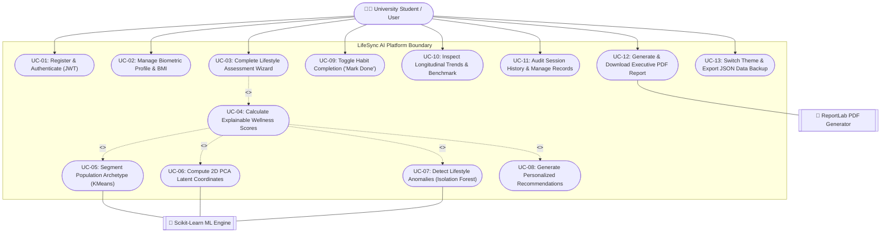

# LifeSync AI — Use Case Model & Actor Specifications

This document defines the behavioral specifications, actor interactions, use case boundaries, and operational workflows implemented across LifeSync AI.

---

## 1. Visual Use Case Diagram

---

## 2. Core Use Case Specifications

### UC-01: Register & Authenticate
* **Primary Actor:** University Student / User.
* **Preconditions:** Client application reachable via browser.
* **Main Success Scenario:**
  1. User navigates to `/register`, enters email, password, full name, age, gender, and occupation.
  2. Frontend sends payload to `POST /api/auth/register`.
  3. Backend hashes password with bcrypt salt factor 12, creates atomic records in `users` and `user_profiles`.
  4. Backend generates signed HS256 JWT access token.
  5. Frontend stores token in `localStorage`, updates React AuthContext, and redirects to `/dashboard`.
* **Alternative Scenario (Demo Access):** User clicks "Instant Demo Access" on `/login` to instantly initialize pre-configured student session.

### UC-03: Complete Lifestyle Assessment Wizard
* **Primary Actor:** University Student / User.
* **Preconditions:** User authenticated with active JWT token.
* **Main Success Scenario:**
  1. User opens `/assessment` and progresses through 6 structured steps:
     - Step 1: Sleep Duration & Quality
     - Step 2: Physical Activity & Sedentary Hours
     - Step 3: Nutrition & Daily Hydration
     - Step 4: Mental Wellbeing & Mindfulness
     - Step 5: Digital Hygiene & Screen Habits
     - Step 6: Substance Habits & Review
  2. User reviews answers and clicks "Submit Complete Assessment".
  3. Frontend sends payload to `POST /api/assessment/`.
  4. Backend runs scoring calculations (UC-04), ML clustering (UC-05), PCA projection (UC-06), anomaly detection (UC-07), and recommendation generation (UC-08).
  5. Results are persisted atomically to SQLite.
  6. Frontend receives full serialized assessment detail and redirects user to `/assessment/results`.

### UC-05: Segment Population Archetype (K-Means)
* **Primary Actor:** Scikit-Learn ML Engine (Internal).
* **Preconditions:** Assessment questionnaire submitted.
* **Main Success Scenario:**
  1. ML Engine extracts 10-dimensional feature vector.
  2. Applies `StandardScaler` fitted on $N=1,500$ population dataset.
  3. Evaluates standardized vector against fitted `KMeans(n_clusters=4)`.
  4. Predicts cluster label (0: Balanced High-Achiever, 1: Sedentary Overextended, 2: Irregular Burnout, 3: Wellness Optimizer).
  5. Calculates Euclidean distance to centroid.
  6. Returns cluster name and descriptive summary.

### UC-07: Detect Lifestyle Anomalies (Isolation Forest)
* **Primary Actor:** Scikit-Learn ML Engine (Internal).
* **Preconditions:** Feature vector standardized.
* **Main Success Scenario:**
  1. Passes standardized vector to trained `IsolationForest(n_estimators=100, contamination=0.08)`.
  2. Calculates anomaly decision function score.
  3. Flags `is_anomaly=True` if decision function $< 0$.
  4. Performs z-score feature attribution to identify outlier drivers (e.g., extreme screen hours $>14\text{h}$ combined with sleep $<4\text{h}$).
  5. Attaches anomaly tags to assessment output.

### UC-09: Toggle Habit Completion
* **Primary Actor:** University Student / User.
* **Preconditions:** Assessment generated with recommendations.
* **Main Success Scenario:**
  1. User navigates to `/recommendations`.
  2. User clicks "Mark Done" toggle on a specific micro-habit card.
  3. Frontend sends `PATCH /api/recommendations/{id}/toggle`.
  4. Backend toggles `is_completed` boolean in `wellness_recommendations` table.
  5. Frontend reactively updates completion percentage and badge state.

### UC-12: Generate & Download Executive PDF Report
* **Primary Actor:** University Student / User.
* **Secondary Actor:** ReportLab PDF Generator.
* **Preconditions:** User has at least one completed assessment session.
* **Main Success Scenario:**
  1. User clicks "Download PDF Report" on `/assessment/results`, `/history`, or `/dashboard`.
  2. Frontend sends request to `GET /api/assessment/{id}/pdf`.
  3. Backend verifies user ownership, serializes assessment scores, ML archetype, and recommendations.
  4. ReportLab compiles two-page styled document with executive headers, pillar score tables, and academic disclaimers.
  5. Backend streams binary `%PDF-1.4` file as attachment download.
  6. Browser automatically downloads `LifeSync_Report_#{id}.pdf`.
